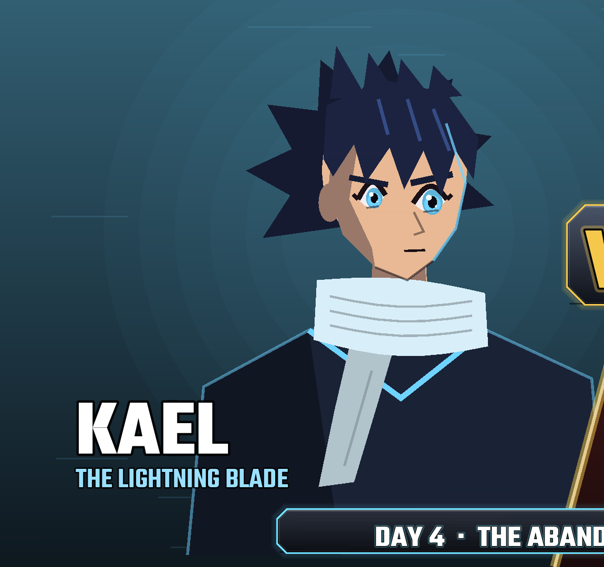
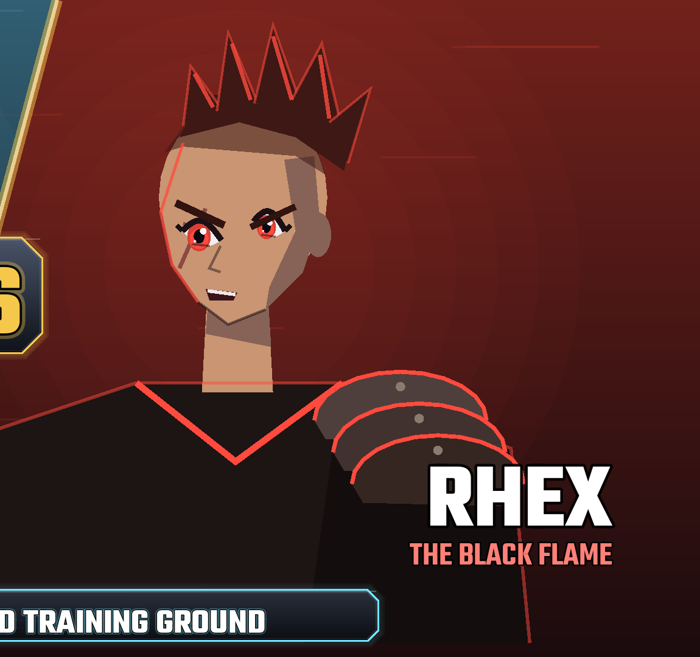

# THE CENTROID — Making the 3D Characters (step by step)

**Claude makes the character models.** Concept art and textured 3D models are generated
on your free **Kaggle** GPUs:
- **FLUX.2 [klein]** makes the concept art;
- Tencent's **Hunyuan3D-2** turns each concept into a textured 3D model;
- each model is converted to a **Mixamo-ready ZIP**.

**Your step is Mixamo** (mixamo.com, free with an Adobe account). It adds the
**skeleton** and the **motion-captured fight animations**. I then import everything into
the game, connect it to the fight system, and add effects, lighting and camera work.

Where things are:
- every character's ZIP is at `assets/characters/<name>/<name>_mixamo.zip`, with a
  4-view preview next to it (`<name>_preview.png`);
- the cast overview is `docs/ref/cast_concepts.png`.

**Start with the pilot: Kael, Rhex, and the animation pack (Part 3).**

---

## Part 0 — Meet the pilot characters (what they must look like)

Read this before generating anything. The descriptions tell you **what to ask the AI
for** and **how to judge the result**. The reference images in `docs/ref/` show the
colours and features from the current game art. Use them for colours and recognizable
features, not as the final style: the 3D models should look more realistic and detailed.

| Kael (`docs/ref/kael_reference.png`) | Rhex (`docs/ref/rhex_reference.png`) |
|---|---|
|  |  |

### KAEL — "The Lightning Blade" (the hero, 19 years old)

**At a glance:** recognizable from across the arena by his **spiky dark hair**, the **long
pale scarf trailing behind him**, and a **slim sword glowing blue at the edge**. Lean and
quick, like a sprinter.

**Body**
- About 1.78 m tall.
- Lean, athletic build: toned but slim, a runner, not a bodybuilder.
- Long arms and legs, narrow waist, shoulders slightly wider than the hips.
- Upright, confident posture: chin level, ready to move.

**Face**
- Young (19), sharp and clean: defined cheekbones, narrow chin, no facial hair, no
  scars.
- **Light-blue eyes**; straight, determined eyebrows.
- Default expression: **serious and focused**, never smiling smugly.
- Skin: light warm tone.

**Hair**
- **Dark navy-black, spiky**, swept **backward**, like wind blew it back.
- A few sharp spikes fall over the forehead.
- Medium length; not long enough to cover the eyes.

**Outfit (top to bottom)**

| Piece | Look | Colour |
|---|---|---|
| Scarf | Long and soft, wrapped once around the neck; **one long end hangs down his back** to about the waist | pale blue-white `#d8eef8` |
| Jacket | Short and fitted (ends at the waist), high collar, sleeves to the wrist | dark navy `#1a2236` |
| Jacket trim | Thin **glowing** lines along the collar, the front opening and the hems | light blue `#6fd3ff` |
| Coat tails | Two split tails hanging from the back of the jacket down to mid-thigh | dark navy `#1a2236` |
| Belt | Slim belt | light blue `#6fd3ff` |
| Trousers | Fitted, flexible fighting trousers | black `#0d0f14` |
| Bracers | Leather forearm guards, each with a thin blue band | dark brown leather + blue |
| Boots | Light armoured boots to mid-shin, slim | black with steel toe caps |

**Weapon (made as a separate model)**
- A **single-edged, slightly curved sword**, about 1 m long (blade 75 cm).
- Dark steel blade with a **faint blue glowing edge**, a **round guard** and a wrapped grip.
- He holds it in his **right hand**.

**Colour rule:** mostly **dark navy and black**. Blue appears only as **thin glowing
accents**, and the **scarf is the one large light-coloured area**.

**Personality to show:** focused, restless, protective. He looks ready to defend, not to
show off.

**Check your Kael model**
- [ ] Slim build, clearly thinner than Rhex.
- [ ] Spiky dark hair swept back.
- [ ] Pale scarf with a hanging end.
- [ ] Short navy jacket with split coat tails.
- [ ] Blue thin trim, not a bright blue outfit.
- [ ] Both hands free and open (the sword is a separate file).
- [ ] No cape covering the arms.

---

### RHEX — "The Black Flame" (the traitor, about 25 years old)

**At a glance:** recognizable by his **red mohawk crest**, a **big layered metal plate on
one shoulder**, **bare muscular arms**, and a **huge black axe with a red-hot edge**.
Bulky, aggressive, takes up space.

**Body**
- About 1.88 m tall, **clearly taller and much broader than Kael**.
- Heavily muscled: thick neck, big shoulders and arms, solid torso.
- Wide, planted stance: feet apart, weight forward, like a brawler.

**Face**
- Square, strong jaw; heavy brow.
- A **scar running diagonally across his left cheek** (from below the eye toward the jaw).
- **Red eyes**.
- Default expression: an **arrogant half-smirk**, one corner of the mouth raised.
- Skin: medium warm tone.

**Hair**
- **Dark red spiky mohawk**: a tall crest of spikes running from the forehead to the
  back of the head.
- **Shaved sides**, shown as a short dark stubble.

**Outfit (top to bottom)**

| Piece | Look | Colour |
|---|---|---|
| Pauldron | **Three overlapping curved steel plates on his LEFT shoulder only**, riveted, with red-painted edges. When he faces you it appears on the **right side of the picture**, as in the reference image. | blackened steel + red edges `#ff4a3d` |
| Armour vest | **Sleeveless** dark leather battle armour, V-neck with red trim | near-black brown `#1d1414` |
| Arms | **Bare upper arms**; cloth wraps from wrist to elbow on both forearms | wraps in dusty grey-brown |
| Belt | Wide belt with a metal buckle | red `#ff4a3d` |
| Trousers | Heavy, loose-fitting fighting trousers | dark brown-black |
| Boots | **Heavy, chunky boots** with straps | black leather |

**Weapon (made as a separate model)**
- A **large single-bladed battle axe**, about 1.2 m long.
- **Blackened steel head** with a **glowing red cutting edge**, a short **spike on the
  back** of the head, and a long dark wooden handle wrapped near the bottom.
- He uses it **two-handed**.

**Colour rule:** **dark leather and dark steel** everywhere. **Red appears only on edges,
trims, the belt, his eyes and his hair**. No large red clothing areas.

**Personality to show:** arrogant, aggressive, enjoys the fight. He looks like he's about
to laugh at you.

**Check your Rhex model**
- [ ] Clearly broader and taller than Kael.
- [ ] Red mohawk with shaved sides.
- [ ] Scar on the left cheek.
- [ ] Shoulder plates on the left shoulder only.
- [ ] Sleeveless with bare upper arms.
- [ ] Forearm wraps.
- [ ] Hands free (the axe is a separate file).

---

### Kael vs. Rhex — they must read as opposites
| | Kael | Rhex |
|---|---|---|
| Body | lean, quick | broad, heavy |
| Colour | dark navy + **blue** glow | dark leather + **red** glow |
| Signature piece | long pale **scarf** | steel **shoulder plates** |
| Weapon | slim curved **sword** | huge **axe** |
| Mood | focused, protective | arrogant, aggressive |

### Do / don't (for every character)
- **Do:**
  - full body, **A-pose**, arms away from the body, hands open;
  - plain background;
  - realistic proportions (head about 1/7.5 of body height);
  - detailed clothing.
- **Don't:**
  - chibi or cartoon proportions or oversized heads;
  - **glowing whole-body effects** or flames on the character (the game adds glow and
    fire itself);
  - weapons attached to the hands;
  - capes that cover the arms;
  - text, logos or symbols from real brands on clothes.

---

## Part 1 — How the models are made (done by Claude)

```
python3 tools/models/kaggle_run.py concepts --missing --n 2   # 2 concept candidates per character
python3 tools/models/kaggle_run.py model kael rhex            # textured GLBs -> assets/characters/<name>/raw/
python3 tools/models/prepare_for_mixamo.py assets/characters/kael/raw/kael.glb --name kael --height 1.78
```

The steps:
1. **Concept:** a full-body, front-view A-pose image, made from the design prompts in
   `tools/models/generate_character.py`. Claude picks the best of two candidates. The
   pick is kept as `assets/characters/<name>/concepts/<name>_1.png`.
2. **3D model:** Hunyuan3D-2 runs on Kaggle, about 4 minutes per character.
   - Background removal, then shape, then texture.
   - Output: `raw/<name>.glb` (textured) and `raw/<name>_shape.glb`.
3. **Check:** a 4-view render (front, ¾, side, back), checked by eye.
4. **Convert:** the model is put on the ground, scaled to the character's height and
   reduced to about 30,000 triangles with its texture. The result is
   `<name>_mixamo.zip` (OBJ + MTL + PNG).

Known limit: the AI only sees the front of the concept, so **the back of the outfit
comes out greyer** than the front. It's barely visible in the side-on fight camera, and
it can be fixed later with a back-view concept.

**Licence:** Hunyuan3D-2 uses the Tencent Hunyuan Community License.
- It does not cover the EU, UK or South Korea.
- Products with over 1M monthly users need a separate licence from Tencent.

FLUX.2 [klein] 4B is Apache-2.0.

### Making one yourself instead (optional)
You can also use **3d.hunyuan.tencent.com**: choose Image to 3D with the concept PNG and
download the result. Upload whatever it gives you to `assets/characters/<name>/raw/` and
I'll convert it.

## Your step — rig each character on Mixamo

1. On mixamo.com, click **Upload Character** and choose `<name>_mixamo.zip`
   (from `assets/characters/<name>/`, or the copy I sent you).
2. In the auto-rigger, place the markers on the **chin, wrists, elbows, knees and
   groin**. Leave Skeleton LOD at **Standard**.
3. Check the preview animates correctly, then press **Next**.
4. Click **Download** with these settings:
   - **Format:** FBX Binary (.fbx)
   - **Pose:** T-pose
   - **Skin:** With Skin
5. Rename the file to the character's name, e.g. `kael.fbx`, and upload it to
   `assets/characters/<name>/` (or just `assets/`, and I'll move it).

**Good to know:**
- Set **Skeleton LOD = No Fingers**. AI models have fused fingers, and finger bones
  stretch them.
- **Use Symmetry** on or off both work.
- If the face or hands still warp in Mixamo's preview, that's fine. When importing, I
  make the head move as one solid piece and the hands too, with
  `tools/models/fix_rig.gd`.

### If something goes wrong
| Problem | Fix |
|---|---|
| Mixamo says the upload failed or is too large | Upload the original Hunyuan3D file to `assets/characters/<name>/raw/` and tell me. I'll slim it to about 30,000 triangles and send a ready ZIP. |
| The auto-rigger fails or the preview looks broken (arms stretch with the body) | The arms are probably touching the body. Regenerate in Hunyuan3D from an image with the arms clearly apart, or send me the raw file. |
| The model is grey or white in Mixamo (no colours) | That's fine. Still download it "With Skin"; I put the original colours back in the game from the Hunyuan3D file. Upload that file to `raw/` too. |
| The model is lying down or facing backwards in Mixamo | Use the rotate buttons in Mixamo's upload screen, or send me the raw file and I'll fix the orientation. |
| The download is a strange format (e.g. `.usdz`, `.stl`) | Upload it to `raw/` anyway and tell me; I'll check what I can do. (`.stl` has no colours, so prefer another option if there is one.) |

---

## Part 2 — Upload to the game repository

The files go into the repository **scientistmall/Centroid**:

```
assets/characters/kael/kael.fbx           (rigged model downloaded from Mixamo)
assets/animations/idle.fbx                (animation pack, Part 3)
...
```

Everything else (concepts, raw models, ZIPs, previews) is already in the repository.

**On a PC:**
1. Open the repository on github.com and go to the `assets` folder.
2. Click **Add file → Upload files** and drag the files in. Before uploading, type the
   folder path into the file name box (e.g. `characters/kael/`).
3. Click **Commit changes**.

**Notes:**
- Web uploads allow **25 MB per file**. For bigger files, use **GitHub Desktop**, which
  allows up to 100 MB.
- On a phone, the GitHub app can't upload files, so use the browser in
  "desktop site" mode.
- Then just tell me "Kael uploaded" (or similar) and I'll take it from there.

---

## Part 3 — The animation pack (download ONCE, works for every character)

All characters share these animations. I retarget them onto each model in Godot.

**How to download each clip:**
1. On Mixamo, keep **any one rigged character** selected (Kael is fine).
2. Search for the clip name and pick the closest match.
3. If the clip has an **In Place** checkbox, tick it. This matters: the game moves the
   characters itself.
4. Click **Download** with:
   - **Format:** FBX Binary;
   - **Skin:** **Without Skin**;
   - **Frames per second:** 30;
   - **Keyframe Reduction:** none.
5. **Rename** the file to the name in the left column and upload it to
   `assets/animations/`.

Names change on Mixamo over time, so the right column gives search words. Pick
whichever result looks best.

| Save as | Search on Mixamo for | Used for |
|---|---|---|
| `idle.fbx` | "Fighting Idle" / "Sword And Shield Idle" | standing in fight stance |
| `walk_forward.fbx` | "Fighting Walk Forward" / "Sword And Shield Walk" (In Place) | moving toward the enemy |
| `walk_back.fbx` | "Fighting Walk Backward" / "Sword And Shield Walk Back" (In Place) | moving away |
| `jump.fbx` | "Jump" (In Place) | jumping |
| `light_1.fbx` | "Sword And Shield Slash" / "Standing Melee Attack Horizontal" | 1st light hit |
| `light_2.fbx` | "Standing Melee Attack Backhand" / "Sword And Shield Attack" | 2nd light hit |
| `light_3.fbx` | "Mma Kick" / "Roundhouse Kick" | 3rd light hit (kick finisher) |
| `heavy_1.fbx` | "Standing Melee Attack Downward" / "Great Sword Slash" | heavy overhead |
| `heavy_2.fbx` | "Great Sword High Spin Attack" / "Standing Melee Combo Attack" | heavy finisher |
| `air_attack.fbx` | "Jump Attack" / "Flying Kick" | attack while jumping |
| `block.fbx` | "Sword And Shield Block" / "Center Block" | holding block |
| `block_hit.fbx` | "Sword And Shield Impact" / "Body Block" | blocking a hit |
| `hit_light.fbx` | "Head Hit" / "Hit Reaction" | taking a light hit |
| `hit_heavy.fbx` | "Big Side Hit" / "Stomach Hit" | taking a heavy hit |
| `knockdown.fbx` | "Flying Back Death" / "Knocked Out" | K.O. / knocked down |
| `get_up.fbx` | "Getting Up" / "Stand Up" | getting up between rounds |
| `cast_1.fbx` | "Standing 1H Magic Attack 01" | projectile powers (bolt, wave, lash) |
| `cast_2.fbx` | "Standing 2H Magic Area Attack 01" | area powers (burst, curse, wall) |
| `buff.fbx` | "Standing 2H Cast Spell 01" / "Power Up" | self powers (purify, veil, clear sight) |
| `dash.fbx` | "Sprinting Forward Roll" / "Dodging" / "Running Slide" | dash powers (Thunder Step) |
| `victory.fbx` | "Victory" / "Fist Pump" / "Sword And Shield Power Up" | winning a round |
| `defeat.fbx` | "Defeated" / "Kneeling" | losing |
| `intro.fbx` | "Sword And Shield Draw" / "Taunt" | fight intro |

Weapon styles differ (spear, whip, gauntlets), but this pack covers everyone for now. I
make each fighter look distinct with timing, effects and weapon trails. Later we can
add a few style-specific clips (e.g. "spear thrust" for Tala).

---

## Part 4 — Character briefs (paste into the image or 3D tool)

Common style line to add to every brief:
> stylized realistic dark-fantasy martial artist, anime-inspired proportions, detailed costume, game-ready character, PBR materials

### Pilot
**KAEL** (hero, about 19) — *colour: electric blue*
> Young man, 19, lean athletic build, about 1.78 m, spiky dark navy-black hair swept backward, light blue eyes, serious determined face, no scars. Short dark navy (#1a2236) fitted jacket with high collar, split coat tails to mid-thigh and thin glowing light-blue (#6fd3ff) trim, long pale blue-white (#d8eef8) scarf with one end hanging down the back, black fitted trousers, leather bracers with thin blue bands, slim light armored boots, light-blue belt.

Weapon:
> slightly curved single-edged sword about 1 m long, dark steel blade with faint glowing blue edge, round guard, wrapped grip

**RHEX** (traitor, about 25) — *colour: red*
> Young adult man, about 25, very broad heavily muscled build, about 1.88 m, square jaw, dark red spiky mohawk crest with shaved stubble sides, diagonal scar across the left cheek, red eyes, arrogant half-smirk. Sleeveless near-black leather (#1d1414) battle armor with red V-neck trim, three overlapping riveted steel plates on the LEFT shoulder only with red edges, bare upper arms, grey-brown cloth wraps on both forearms, wide red (#ff4a3d) belt, heavy dark trousers, chunky strapped black boots.

Weapon:
> large single-bladed battle axe about 1.2 m long, blackened steel head with glowing red cutting edge and a short back spike, long dark wooden handle wrapped near the bottom

### Part One fighters
**TALA** (mentor, about 30) — *colour: jade green*
> Athletic woman, dark hair in a high ponytail, calm focused eyes, light leather armor with jade-green cloth panels, arm wraps, practical boots.

Weapon:
> long spear with leaf-shaped blade and green cloth tassel

**VASKA** (traitor, about 20) — *colour: grey-blue*
> Slim young woman, grey-blue hooded cloak, lower face scarf, fitted dark clothing, misty pale colors, light boots.

Weapon:
> pair of short curved twin blades

**DARIN** (guardian, about 28) — *colour: amber*
> Very big powerful man, shaved head, short beard, sleeveless brown and amber fighting gear, thick belt, heavy stone-like armored gauntlets on both forearms and fists.

Weapon: none (the gauntlets are part of the model).

**MAEL** (traitor, about 28) — *colour: violet*
> Muscular disciplined man, short dark hair, stern face, dark violet monk-style fighting robes, armored fists, floating rock motif embroidery.

Weapon: none (armored fists).

**MIRA** (guardian, about 20) — *colour: rose pink*
> Young woman, long dark hair with rose-pink tint, gentle but strong face, elegant fitted light armor in white and rose pink with moon motifs, flowing half-cape.

Weapon:
> segmented flexible whip-sword, silver blade segments

**NYRA** (traitor, Mira's older sister, about 25) — *colour: poison green*
> Elegant woman, long dark hair, cold expression, black and poison-green fitted outfit with thorn motifs, long gloves.

Weapon:
> long leather whip with green metal tip

### Story characters (needed later, for story scenes and future fights)
- **AUREN** (founder, about 60, gold):
  > older man, long greying hair and short beard, wise kind face, layered gold-trimmed dark robes
- **SERAN** (deputy, about 45, green):
  > calm man, swept-back hair, long green-trimmed leader coat
- **VEYR** (deputy turned villain, about 45, violet):
  > tall intense man, long dark hair, scholar-warrior long coat in black and violet, sword
- **THANE** (Kael's older brother, about 24, violet-black):
  > tall man, spiky dark hair like Kael's, black and violet armor, two swords
- **IREN** (Kael's best friend, about 19, orange):
  > cheerful young man, messy brown hair, orange-accented light armor, twin daggers
- **LYRA** (about 19, pale cyan):
  > young woman, long light hair, pale cyan and white archer outfit, bow
- **OREN** (inventor, about 30, yellow):
  > short hair, goggles on forehead, yellow-accented work gear, mechanical resonance gloves

---

## Checklist for the pilot
- [ ] `assets/characters/kael/raw/` — the original Hunyuan3D download (any format)
- [ ] `assets/characters/kael/kael.fbx` — rigged on Mixamo (+ the weapon model, any format)
- [ ] `assets/characters/rhex/raw/` — the original Hunyuan3D download (any format)
- [ ] `assets/characters/rhex/rhex.fbx` — rigged on Mixamo (+ the weapon model, any format)
- [ ] `assets/animations/*.fbx` — the 23 clips from Part 3
- [ ] Tell me it's uploaded
